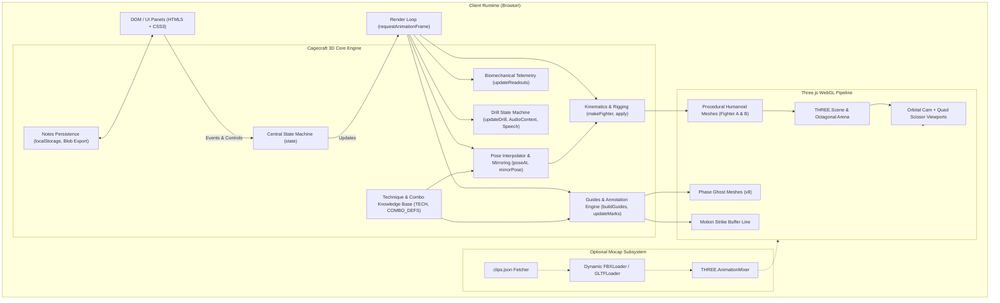
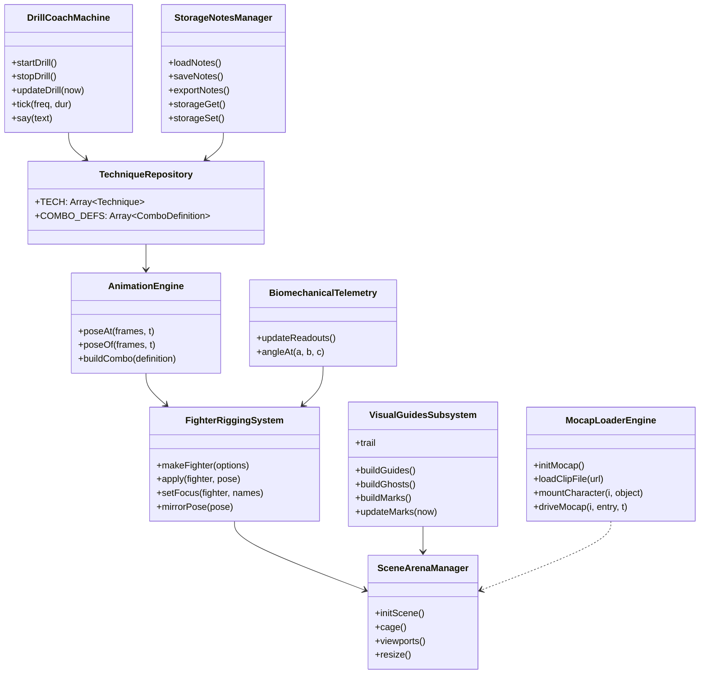

# System Architecture & Technical Baseline — Cagecraft 3D

> **Document Type:** Reverse-Engineered System Design & Architecture  
> **Source Baseline:** `mma.html` (Brownfield Single-File SPA)  
> **Generated By:** Codebase Onboarder (Agent 15)  
> **Date:** 2026-11-11  
> **Repository:** `cage-coach`

---

## 1. System Overview & Tech Stack

### 1.1 Architectural Pattern
**Cagecraft 3D** is an interactive, zero-build, client-side 3D single-page application (SPA) distributed as a standalone monolithic HTML document ([`mma.html`](file:///c:/Activities/Projects/cage-coach/mma.html)). The system is built around Three.js WebGL rendering, custom forward kinematics, procedural geometric humanoids ("clay models"), dynamic visual biomechanical telemetry, and an interactive state-machine drill coach.



### 1.2 Tech Stack Inventory

| Tier / Role | Technology / Specification | Version / Source | Configuration File |
| :--- | :--- | :--- | :--- |
| **Runtime Environment** | Web Browser (Chromium / Firefox / WebKit) | Modern Evergreen HTML5/ES6+ | N/A (Standalone) |
| **Package Management** | None (`[MISSING]`) | N/A | None (`package.json` missing) |
| **Core 3D Engine** | Three.js | `r128` (CDN: `cdnjs.cloudflare.com`) | Loaded via `<script>` |
| **Styling & Fonts** | Google Fonts (`Barlow`, `Barlow Condensed`) + Custom CSS | CSS3 Variables (Dark/Light scheme) | Inline `<style>` in [`mma.html`](file:///c:/Activities/Projects/cage-coach/mma.html#L9-L106) |
| **Audio Synthesis** | Web Audio API (`AudioContext`, `OscillatorNode`, `GainNode`) | Native Browser API | Inline in `tick()` |
| **Speech Synthesis** | Web Speech API (`SpeechSynthesisUtterance`) | Native Browser API | Inline in `say()` |
| **Persistence** | Web Storage API (`localStorage`) + `Blob` file download | Key: `cagecraft3d-notes` | Inline in `storageGet()` / `storageSet()` |
| **Optional Mocap Loaders** | `FBXLoader.js`, `GLTFLoader.js`, `fflate.min.js` | `0.128.0` (Dynamic CDN: `unpkg.com`) | Dynamically appended `<script>` |
| **Static Analysis & Linters** | **`[MISSING]`** | None configured | Recommend `.eslintrc.json` / `prettier` |
| **Test Runner & Coverage** | **`[MISSING]`** | 0% automated coverage | Recommend Vitest + Playwright |

---

## 2. Component Map

All components currently live within [`mma.html`](file:///c:/Activities/Projects/cage-coach/mma.html). The functional boundaries are mapped below:



### 2.1 Component Specifications

#### Component 1: Scene & Arena Manager
- **Location:** [`mma.html#L579-L632`](file:///c:/Activities/Projects/cage-coach/mma.html#L579-L632), [`#L1236-L1253`](file:///c:/Activities/Projects/cage-coach/mma.html#L1236-L1253)
- **Responsibility:** Instantiates the WebGLRenderer, Scene, lighting rig, fog, cameras, and the procedural octagonal MMA cage arena with mat, posts, and vinyl padding; manages split-screen scissor viewports.
- **Exposes:** `renderer`, `scene`, `camera`, `fixedCams`, `viewports()`, `resize()`.
- **Depends on:** Three.js (`THREE.WebGLRenderer`, `THREE.PerspectiveCamera`, `THREE.CylinderGeometry`, `THREE.CanvasTexture`).
- **Data Owned:** Scene graph, canvas viewport dimensions, lighting vectors.
- **Failure Mode:** WebGL context creation failure gracefully throws browser error; resize listener auto-adapts to viewport geometry.

#### Component 2: Fighter Rigging & Kinematics Engine
- **Location:** [`mma.html#L633-L740`](file:///c:/Activities/Projects/cage-coach/mma.html#L633-L740)
- **Responsibility:** Builds the hierarchical procedural "clay" humanoid skeleton, assigns anatomical tracking markers (`f.points`), manages joint coordinate rotations (`YXZ` for shoulders/hips, `XYZ` for elbows/knees/wrists/ankles), and handles limb emissive highlighting.
- **Exposes:** `makeFighter({skin, accent, ghost})`, `apply(fighter, pose)`, `setFocus(fighter, names)`, `mirrorPose(pose)`, instances `A`, `B`, `S`, `ghosts`.
- **Depends on:** Three.js Object3D hierarchies, joint matrices.
- **Data Owned:** Joint transform hierarchies, anatomical marker groups (`hips`, `chest`, `neck`, `head`, `eyes`, `lGlove`, `rGlove`, `lElbow`, `rElbow`, `lKnee`, `rKnee`, `lFoot`, `rFoot`).
- **Failure Mode:** Silent omission if joint names are misconfigured; falls back to default `STANCE` values.

#### Component 3: Animation & Pose Interpolation Engine
- **Location:** [`mma.html#L200-L269`](file:///c:/Activities/Projects/cage-coach/mma.html#L200-L269), [`#L529-L577`](file:///c:/Activities/Projects/cage-coach/mma.html#L529-L577), [`#L713-L740`](file:///c:/Activities/Projects/cage-coach/mma.html#L713-L740)
- **Responsibility:** Evaluates multi-joint spatial positions across normalized time (`t` in `[0, 1]`) using cubic easing; performs horizontal coordinate symmetry flipping for Southpaw stance; compiles multi-step combinations into continuous timelines.
- **Exposes:** `poseAt(frames, t)`, `poseOf(frames, t)`, `fullPose(partial)`, `buildCombo(def)`.
- **Depends on:** `STANCE` pose constants, `JOINTS` catalog.
- **Data Owned:** Keyframe array timelines for fighter and partner.
- **Failure Mode:** Out-of-bounds `t` clamps to nearest keyframe boundary.

#### Component 4: Technique Knowledge Base
- **Location:** [`mma.html#L270-L528`](file:///c:/Activities/Projects/cage-coach/mma.html#L270-L528), [`#L569-L577`](file:///c:/Activities/Projects/cage-coach/mma.html#L569-L577)
- **Responsibility:** Central static repository of martial arts technique definitions across striking, grappling, takedowns, submissions, defenses, and combinations.
- **Exposes:** `TECH` (array of 24 techniques), `COMBO_DEFS`, `byKey` map.
- **Depends on:** Pose constants (`JAB_IMPACT`, `CROSS_IMPACT`, `DOUBLE_A`, `MOUNT_A`, etc.).
- **Data Owned:** Technique metadata, descriptions, contact marks, phase breakdowns, coaching cues.
- **Failure Mode:** Read-only constant structures; immutable during application lifecycle.

#### Component 5: Visual Guides & Annotation Engine
- **Location:** [`mma.html#L742-L881`](file:///c:/Activities/Projects/cage-coach/mma.html#L742-L881), [`#L984-L990`](file:///c:/Activities/Projects/cage-coach/mma.html#L984-L990)
- **Responsibility:** Renders dynamic 3D visual coaching cues including pulsed contact rings, billboarded text sprites, rotational hip/shoulder arc tubes (`CatmullRomCurve3`), strike trajectory line trails (`BufferGeometry`), mat foot placement stamps, and phase ghost models.
- **Exposes:** `buildGuides()`, `buildGhosts()`, `buildMarks()`, `updateMarks(now)`, `trail`, `trailGeo`.
- **Depends on:** Three.js Sprites, Dynamic Canvas 2D text generation, landmark world coordinates.
- **Data Owned:** `markGroup`, `guideGroup`, `ghosts` mesh pool.
- **Failure Mode:** Disposes old geometries/textures via `disposeGroup()` to prevent memory leaks during transitions.

#### Component 6: Biomechanical Telemetry Subsystem
- **Location:** [`mma.html#L882-L908`](file:///c:/Activities/Projects/cage-coach/mma.html#L882-L908)
- **Responsibility:** Computes real-time 3D joint angles (knee bends, elbow extensions, hip rotation angle, torso lean angle/direction) and spatial clearances (head height, hand height) from world-space landmark positions.
- **Exposes:** `updateReadouts()`, `angleAt(a, b, c)`.
- **Depends on:** DOM elements (`#r-lk`, `#r-rk`, `#r-le`, `#r-re`, `#r-hip`, `#r-lean`, `#r-head`, `#r-hand`), Landmark points from Rig or Mocap.
- **Data Owned:** Telemetry readout DOM cache (`RO`).
- **Failure Mode:** Throttled to execute every 3 animation frames; gracefully outputs em-dash (`–`) when landmark points are unresolvable.

#### Component 7: Interactive Drill Coach State Machine
- **Location:** [`mma.html#L1075-L1128`](file:///c:/Activities/Projects/cage-coach/mma.html#L1075-L1128)
- **Responsibility:** Orchestrates an automated random-call drill session with audio-visual cues: signals technique by name and hotkey, counts down execution window, plays reference animation, and loops.
- **Exposes:** `startDrill()`, `stopDrill()`, `updateDrill(now)`, `tick(freq, dur)`, `say(text)`.
- **Depends on:** Web Audio API (`AudioContext`), Web Speech API (`speechSynthesis`), DOM elements (`#callout`, `#drill`).
- **Data Owned:** `drill` state dictionary (`set`, `gap`, `phase`, `at`, `last`, `audio`).
- **Failure Mode:** Wrapped in try/catch blocks; silently disables audio/speech if browser permissions or Web Audio/Speech APIs are blocked.

#### Component 8: Notes Persistence Manager
- **Location:** [`mma.html#L1052-L1074`](file:///c:/Activities/Projects/cage-coach/mma.html#L1052-L1074)
- **Responsibility:** Provides local-first persistence for user technique study notes, with debounced auto-saving to browser storage and complete JSON export.
- **Exposes:** `loadNotes()`, `saveNotes()`, `storageGet()`, `storageSet()`.
- **Depends on:** `window.localStorage`, `Blob`, `URL.createObjectURL`.
- **Data Owned:** `notesMem` in-memory object, `localStorage['cagecraft3d-notes']`.
- **Failure Mode:** Falls back to session memory if `localStorage` is disabled or throws `SecurityError` / quota exceeded.

#### Component 9: Optional Motion Capture Module
- **Location:** [`mma.html#L911-L983`](file:///c:/Activities/Projects/cage-coach/mma.html#L911-L983)
- **Responsibility:** Dynamically fetches `clips.json` manifest, loads external FBX or GLTF skinned characters and animation clips, and drives Three.js `AnimationMixer` sync with playback time.
- **Exposes:** `initMocap()`, `setSrc(s)`, `driveMocap(i, entry, t)`, `mocapClipFor(tk)`.
- **Depends on:** Dynamic script injection (`fflate.min.js`, `FBXLoader.js`, `GLTFLoader.js`), `clips.json`.
- **Data Owned:** `mocap` controller object (`clips`, `chars`, `mixers`, `actions`, `bones`).
- **Failure Mode:** Silently degrades to procedural "Clay" mode if `clips.json` is missing (404) or external scripts fail to load.

---

## 3. API & Interface Contracts

### 3.1 External File Manifests

#### 3.1.1 Motion Capture Manifest (`clips.json`)
Optional file fetched via `GET clips.json` at startup:

```json
{
  "character": "models/character.glb",
  "clips": {
    "1": {
      "a": "clips/jab_a.fbx",
      "b": "clips/jab_b.fbx",
      "phases": [
        [0.32, "Extend", "Lead hand shoots straight..."],
        [0.45, "Impact", "Arm fully straight..."],
        [1.0, "Retract", "Hand returns..."]
      ]
    }
  }
}
```

#### 3.1.2 Exported Notes File (`cagecraft-notes.json`)
Generated on client side via `Blob`:

```json
{
  "1 Jab": "Remember to rotate shoulder up to protect the chin.",
  "W Double leg": "Drive off the back foot, don't bend at the waist."
}
```

### 3.2 Keyboard & Command Bus

The application listens for key events on `window` ([`mma.html#L1197-L1223`](file:///c:/Activities/Projects/cage-coach/mma.html#L1197-L1223)):

| Key | Action | Scope / Parameter |
| :--- | :--- | :--- |
| `1` – `0` | Select Striking Technique | Striking (Jab, Cross, Hook, Uppercut, Elbow, Knee, Teep, Roundhouse, Slip, Check) |
| `Q` – `P` | Select Grappling Technique | Grappling (Collar Tie, Double Leg, Single Leg, Hip Toss, Sprawl, Mount, Guard, Side Control, RNC, Armbar) |
| `Z`, `X`, `N`, `H`, `J`, `K` | Select Combination | Combos (1-2, 1-2-3, Teep-Cross, Clinch-Knee, Double-Mount, Cross-Hook-Knee) |
| `Space` | Toggle Play / Pause | Playback state (`state.playing`) |
| `[` / `]` | Step Frame Backward / Forward | Steps normalized time `state.t` by `±0.015` |
| `Enter` | Step to Next Phase | Advances `state.t` to the next phase boundary timestamp |
| `Backspace` | Step to Previous Phase | Returns `state.t` to the preceding phase boundary |
| `Tab` | Toggle Mode | Switches between `'single'` and `'spar'` (sparring partner) |
| `A` / `a` | Toggle Stance | Switches between Orthodox and Southpaw (`state.southpaw`) |
| `M` / `m` | Toggle Rig Source | Switches between Procedural `'clay'` and Mocap `'mocap'` (if available) |
| `G` / `g` | Toggle Ghost Keyframes | Enables/disables ghost clone visualization (`state.ghosts`) |
| `F` / `f` | Toggle Visual Guides | Enables/disables rotation arcs, footprints, and joint highlights |
| `L` / `l` | Toggle Phase Stepping | Auto-pauses animation at each phase milestone (`state.step`) |
| `V` / `v` | Toggle Split Viewport | Toggles Quad-View scissor mode (Orbit, Side, Top, Behind) |
| `D` / `d` | Toggle Drill Coach | Starts/stops the automated training drill state machine |
| `S` / `s` | Cycle Playback Speed | Cycles between `1x` → `0.5x` → `0.25x` |
| `C` / `c` | Cycle Camera Angle | Front (0) → Side (1) → Above (2) → Behind (3) → Partner's Eyes (4) |
| `Arrow Keys` | Pan Camera Angle | Orbit azimuth (`theta`) and elevation (`phi`) adjustment |

---

## 4. Data Models & State Architecture

### 4.1 Global Runtime State

```ts
interface ApplicationState {
  tech: number;         // Index into TECH array (0..23)
  mode: 'single' | 'spar'; // Sparring partner visibility
  speed: 1 | 0.5 | 0.25;// Playback time multiplier
  playing: boolean;     // Animation playback active flag
  t: number;            // Normalized cycle progress (0.000 to 1.000)
  cam: 0 | 1 | 2 | 3 | 4; // Camera preset index
  src: 'clay' | 'mocap';// Active visual rig source
  ghosts: boolean;      // Phase ghost meshes visible
  guides: boolean;      // Footprints, rotation arcs, marks visible
  step: boolean;        // Auto-pause at phase boundaries
  stepOnce: boolean;    // Advance exactly one phase and halt
  split: boolean;       // Quad-viewport scissor mode active
  drill: boolean;       // Interactive drill trainer active
  southpaw: boolean;    // Horizontal coordinate mirror active
}
```

### 4.2 Technique Definition Model

```ts
interface Technique {
  key: string;                    // Trigger character ('1', 'Q', 'Z')
  group: 'strike' | 'grapple' | 'combo'; // Classification group
  name: string;                   // Display title ("Lead hook", "Hip toss")
  side: string;                   // Tactical role ("Lead hand", "Throw, o-goshi")
  dur: number;                    // Animation loop duration in seconds
  a: Keyframe[];                  // Keyframe track for Fighter A
  b: Keyframe[];                  // Keyframe track for Fighter B (partner)
  trace?: string | null;          // Anatomical marker for strike trail ('lGlove', 'rFoot')
  peak: number;                   // Normalized timestamp of peak extension / impact
  focus: JointIdentifier[];       // Joints highlighted with red emissive shader
  phases: [number, string, string][]; // Tuple of [untilNormalizedTime, phaseTitle, phaseDescription]
  marks: ContactMark[];           // 3D spatial contact annotations
  cues: string[];                 // Tactical coaching bullet points
  partner: string;                // Qualitative description of partner reaction
  needsPartner?: boolean;         // Forces partner visibility (grappling techniques)
  cam?: [number, number, number]; // Custom camera focal center override [x, y, z]
  ranges?: ComboSliceRange[];     // Sub-technique ranges (for generated combos)
}

interface Keyframe {
  t: number;                      // Normalized time (0.0 to 1.0)
  p?: Partial<Pose>;              // Joint transform overrides
}

interface ContactMark {
  t0: number;                     // Annotation start normalized time
  t1: number;                     // Annotation end normalized time
  who: 'A' | 'B';                 // Target fighter
  pt: AnatomicalMarkerName;       // Landmark ('lGlove', 'rKnee', 'head', 'hips', etc.)
  label: string;                  // Display text ("Contact: chin", "Lead foot pivots in")
  dy?: number;                    // Vertical offset for billboard sprite
}
```

### 4.3 Pose Spatial Vector Map

```ts
type JointIdentifier = 
  | 'root' | 'spine' | 'head'
  | 'lSh' | 'lEl' | 'lWrist'
  | 'rSh' | 'rEl' | 'rWrist'
  | 'lHip' | 'lKnee' | 'lAnkle'
  | 'rHip' | 'rKnee' | 'rAnkle';

interface Pose {
  pos: [number, number, number];   // Root translation offset [x, y, z]
  root: [number, number, number];  // Root pelvic rotation [degX, degY, degZ]
  spine: [number, number, number]; // Thoracic spine rotation [degX, degY, degZ]
  head: [number, number, number];  // Cranial rotation [degX, degY, degZ]
  lSh: [number, number, number];   // Left shoulder (YXZ order)
  lEl: [number, number, number];   // Left elbow (XYZ order)
  lWrist: [number, number, number];// Left wrist (fist rotation)
  rSh: [number, number, number];   // Right shoulder (YXZ order)
  rEl: [number, number, number];   // Right elbow (XYZ order)
  rWrist: [number, number, number];// Right wrist
  lHip: [number, number, number];  // Left hip joint (YXZ order)
  lKnee: [number, number, number]; // Left knee (flexion degX)
  lAnkle: [number, number, number];// Left ankle (plantarflexion degX)
  rHip: [number, number, number];  // Right hip joint (YXZ order)
  rKnee: [number, number, number]; // Right knee
  rAnkle: [number, number, number];// Right ankle
}
```

---

## 5. Risk Flags & Technical Debt Baseline

| ID | Category | Severity | Finding & Impact | Recommendation |
| :--- | :--- | :--- | :--- | :--- |
| **RF-01** | **Tooling & Toolchain** | **High** | **Missing package manifest and build system.** The repository lacks `package.json`, bundler (e.g. Vite), and module system. Code is bundled into an unminified 1,343-line HTML file. | Initialize standard NPM workspace with Vite and TypeScript to enable modular decomposition. |
| **RF-02** | **Static Analysis** | **High** | **`[MISSING]` linter and code quality tooling.** Zero static analysis configurations (`.eslintrc`, `prettierrc`, `tsconfig.json`). Syntactic and type errors are only discovered at browser runtime. | Introduce ESLint with `@typescript-eslint` and Prettier to enforce baseline quality standards. |
| **RF-03** | **Testing** | **High** | **`[MISSING]` automated testing suite.** 0% test coverage. Pose interpolation math, combo slicing algorithms, and drill state machines have no unit or integration tests. | Add Vitest for math/kinematic testing and Playwright for WebGL visual regression testing. |
| **RF-04** | **Resilience / Network** | **Medium** | **Hardcoded third-party CDN script dependencies.** Three.js, Google Fonts, and unpkg loaders are fetched from external CDNs. In offline environments or behind restricted networks, the application crashes or breaks. | Bundle dependencies locally via NPM packages rather than relying on unpinned CDN URLs. |
| **RF-05** | **Performance & Memory** | **Medium** | **Dynamic Canvas texture allocation in render loops.** `makeLabel` and `makeRing` instantiate new HTML5 2D canvases, rasterize text, and create `CanvasTexture` objects during technique transitions, risking VRAM churn. | Implement a reusable Sprite/Texture atlas or texture caching pool for annotations and labels. |
| **RF-06** | **Performance / GC** | **Medium** | **High object allocation churn in telemetry loop.** `updateReadouts()` runs every 3 frames and invokes `.clone()` on `THREE.Vector3` instances, generating continuous garbage collection pressure. | Pre-allocate scratch vectors (`tmpV1`, `tmpV2`) and perform vector math in-place. |
| **RF-07** | **Accessibility & Mobile** | **Low** | **Keyboard-centric interaction paradigm.** Navigation relies heavily on physical keyboard hotkeys (`Tab`, `Space`, `Enter`, `A`, `1`-`0`). On touch/mobile screens, hotkeys are hidden and card overlays obscure the 3D viewport. | Introduce a touch-friendly on-screen control dock and ensure ARIA live announcements for drill callouts. |
| **RF-08** | **Data Integrity** | **Low** | **Unvalidated LocalStorage notes.** Notes are saved directly from a `<textarea>` into `localStorage` without content sanitization or size-quota validation. | Implement input sanitization and schema versioning (`{ version: 1, notes: { ... } }`). |

---

## 6. Baseline Architecture Decision Records (ADRs)

### ADR-001: Zero-Build Single-File Architecture
- **Context:** The application was authored as a self-contained demonstration and reference tool that can run directly off the local file system (`file:///`) in any modern browser without requiring Node.js, compilation, or web servers.
- **Decision:** Consolidate HTML structure, responsive CSS styles, Three.js 3D rendering, custom forward kinematics, sound synthesis, and data stores into a single [`mma.html`](file:///c:/Activities/Projects/cage-coach/mma.html) file.
- **Consequences:** Maximizes portability and ease of distribution; severely impedes modular code organization, unit testing, static typing, and collaborative development.

### ADR-002: Procedural "Clay" Humanoid Rigging vs Heavy 3D Assets
- **Context:** Delivering realistic martial arts techniques typically requires heavy 3D character meshes, complex bone rigs, and skinning weights (often tens of megabytes per character).
- **Decision:** Construct fighters out of lightweight geometric Three.js primitives (`CylinderGeometry`, `SphereGeometry`, `BoxGeometry`) linked in an explicit hierarchical scene graph.
- **Consequences:** Instantaneous load time, minimal memory footprint, zero asset bandwidth requirements; visual fidelity is stylized ("clay man") rather than photorealistic.

### ADR-003: Parametric Keyframe Pose Interpolation with Symmetry Mirroring
- **Context:** Representing complex striking and grappling mechanics requires smooth continuous motion and support for both Orthodox and Southpaw stances.
- **Decision:** Store discrete anatomical angular coordinates in joint dictionaries (`JOINTS`), interpolate between keyframes using custom cubic easing (`ease(x)`), and apply mathematical mirroring (`mirrorPose`) that swaps bilateral limbs and inverts rotation axes.
- **Consequences:** Negates the need for dual animation sets for left- and right-handed stances; reduces keyframe authoring workload by 50%.

### ADR-004: Pluggable Hybrid Rigging Architecture (Clay + Optional Mocap)
- **Context:** Some users may desire authentic motion capture data when available, without breaking the zero-dependency fallback.
- **Decision:** Design a dual-source engine (`state.src = 'clay' | 'mocap'`) that defaults to the procedural clay model, but probes for an optional `clips.json` manifest. If present, it dynamically loads FBX/GLTF loaders from CDN and retargets animations to skinned meshes.
- **Consequences:** Allows advanced users to drop in Mixamo/BVH/FBX mocap clips without forcing all users to download large animation assets.

### ADR-005: Local-First Client-Side Persistence
- **Context:** Users need to capture personal coaching cues and training notes per technique without requiring user authentication, remote databases, or backend servers.
- **Decision:** Store notes in the browser's `localStorage` (`cagecraft3d-notes`) with fallback to memory, complemented by a client-side JSON file exporter using HTML5 `Blob` downloads.
- **Consequences:** Complete user privacy, instant responsiveness, zero hosting infrastructure cost; notes are bound to a single browser profile unless manually exported.

---

## 7. Downstream SDLC Integration Guide

This document establishes the official source of truth for the `cage-coach` repository. All downstream AI Dev Pipeline agents must reference the boundaries documented here:

- **For New Features (`sdlc-plan`, `sdlc-tasks`):** Refer to Section 2 (Component Map) and Section 4 (Data Models) before defining new modules or UI controls.
- **For Implementation (`sdlc-develop`):** Keep changes compatible with the Three.js r128 WebGL pipeline and adhere to the coding standards in `AGENTS.md`.
- **For Refactoring / Modernization:** When converting to a modular Vite/TypeScript codebase, preserve the kinematic math and keyframe conventions defined in Section 4.3.
- **For Bug Fixes (`sdlc-debug`):** Check Section 5 (Risk Flags) for known edge cases in vector allocation, camera projection, and localStorage quota handling.

