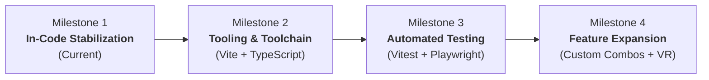

# AI Dev Pipeline — Architecture & Quality Roadmap

> **Project:** Cagecraft 3D (`cage-coach`)  
> **Status:** Active Roadmap & Quality Control Standard  
> **Owner:** AI Dev Pipeline Agents & Development Team  
> **Last Updated:** 2026-11-11

---

## 1. Architectural Vision & Principles

Cagecraft 3D is an accessible, web-native martial arts 3D biomechanics visualizer, combination builder, and interactive drill coach. The system's long-term architectural goal is to maintain its instant, friction-free local execution while evolving toward a modular, well-tested, and extensible engineering baseline.

### Core Architectural Principles

1. **Deterministic Forward Kinematics (Zero Black Box Math):**
   * All procedural joint angles, cubic easing interpolations, and bilateral symmetry coordinate transforms must remain explicit, transparent, and mathematically verifiable.
   * Coordinate conventions are invariant: `YXZ` rotation order for multiaxial ball-and-socket joints (shoulders, hips) and `XYZ` for hinge/planar joints (knees, elbows, wrists, ankles).

2. **Zero-Allocation 60fps Hot Path:**
   * The render loop (`frame()`) and high-frequency telemetry ticker (`updateReadouts()`) must never allocate heap objects (such as `new THREE.Vector3()` or `.clone()`).
   * Scratch vectors, Euler angles, and matrices must be pre-allocated statically at module scope and reused in-place.

3. **Asset & Memory Conservation:**
   * Procedural clay geometry is the first-class citizen: instantaneous load time, lightweight memory footprint, and zero network requirement.
   * Texture generation (canvas billboard labels, contact rings) must be cached in memory (`labelTexCache`, `sharedRingTex`) to eliminate GPU texture re-upload churn.

4. **Local-First Privacy & Portability:**
   * User training cues and notes belong to the user and reside in browser storage with single-click JSON export. No user accounts, tracking cookies, or mandatory server backends are required for core functionality.

5. **Graceful Multi-Tier Degradation:**
   * The application must function completely offline. Optional capabilities (such as motion capture clip loading via `clips.json` or speech synthesis callouts) must cleanly degrade without breaking the core 3D viewer.

---

## 2. Technical Modernization Roadmap

The technical evolution of Cagecraft 3D is structured across four progressive milestones:

### Milestone 1: In-Code Stabilization (Completed)
- [x] Fix high-frequency memory allocation churn in `updateReadouts()` (zero-allocation telemetry).
- [x] Implement texture caching for `makeLabel()` and `makeRing()` to prevent WebGL texture leaks.
- [x] Harden `localStorage` persistence with input length capping and quota handling.
- [x] Add `touch-action: none` to canvas to prevent mobile touch gesture conflicts.
- [x] Establish reverse-engineered architecture documentation (`docs/architecture.md`).

### Milestone 2: Tooling & Modularization Baseline
- [ ] Initialize standard NPM project workspace (`package.json`).
- [ ] Vendor or bundle Three.js locally via NPM to remove CDN downtime/offline vulnerability.
- [ ] Configure Vite build pipeline with TypeScript (`tsconfig.json`).
- [ ] Configure strict static analysis: ESLint (`@typescript-eslint`) and Prettier.
- [ ] Decompose monolithic `mma.html` into modular TypeScript files:
  - `src/engine/scene.ts` (arena, lighting, viewports, cameras)
  - `src/engine/rig.ts` (skeleton, procedural meshes, markers)
  - `src/engine/kinematics.ts` (interpolation, cubic easing, southpaw mirror)
  - `src/engine/telemetry.ts` (joint angle calculations, spatial readouts)
  - `src/data/techniques.ts` (striking, grappling, combos)
  - `src/drill/coach.ts` (state machine, Web Audio metronome, Speech API)
  - `src/ui/` (HUD, controls, card panels, responsive overlays)

### Milestone 3: Automated Quality & Testing Gates
- [ ] Setup Vitest test runner for unit tests.
- [ ] Write unit tests for kinematic calculations (`angleAt`, `mirrorPose`, `poseAt`).
- [ ] Write unit tests for combo compiler (`buildCombo`).
- [ ] Setup Playwright for end-to-end WebGL canvas smoke tests and viewport regression testing.
- [ ] Enforce zero-linter-error policy before pull request merges.

### Milestone 4: Feature Expansion & Next-Gen Capabilities
- [ ] User custom combination builder UI (allow users to chain arbitrary techniques into new combos).
- [ ] Technique playback comparison slider (side-by-side ghost comparison between two techniques).
- [ ] WebXR / Spatial computing viewer (previewing 3D strikes inside VR/AR headsets).
- [ ] Audio cue expansion (custom voice packs and round-timer bells).

---

## 3. Quality Control & Review Gates

Every modification to the codebase must pass the following pipeline gates:

1. **Kinematic Integrity:**
   * Does Fighter A or B penetrate the mat plane (`y < -0.04`) during any strike or transition?
   * Does Southpaw mirroring (`state.southpaw = true`) preserve anatomical limb angles and trajectory directions?
2. **Performance Budget:**
   * Frame budget: 60 fps (16.6ms per frame) on standard mobile/desktop hardware.
   * Zero heap allocations inside `requestAnimationFrame` loop.
3. **Responsive Ergonomics:**
   * All UI controls must remain accessible across desktop (split-screen mode) and mobile viewports (<760px).
   * Mobile touch interactions must not conflict with 3D orbit controls.
4. **Documentation Sync:**
   * Any change to technique data structures, poses, or component boundaries must be updated in `docs/architecture.md`.

