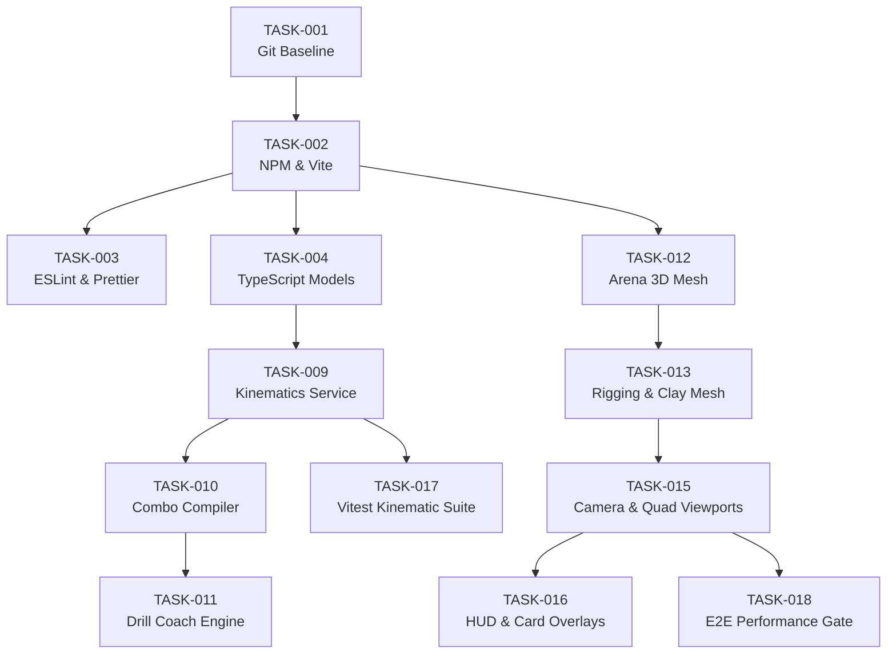

# Task Backlog — Cagecraft 3D (Cage Coach)

> **Document Type:** Ordered Atomic Task Backlog & Traceability Matrix  
> **Source Baseline:** `docs/architecture.md`, `docs/requirements.md`, `docs/user-stories.md`, `docs/design-specs.md`  
> **Generated By:** Task Planner (Agent 5)  
> **Date:** 2026-11-11  

---

## 1. Task Backlog Overview

| Layer | Layer Name | Total Tasks | Completed | In-Progress | Pending |
| :---: | :--- | :---: | :---: | :---: | :---: |
| **1** | Infrastructure & Tooling | 3 | 2 | 0 | 1 |
| **2** | Data Models & Persistence | 2 | 2 | 0 | 0 |
| **3** | Contracts & Command Interfaces | 2 | 0 | 0 | 2 |
| **4** | Business Logic & Kinematics Services | 4 | 4 | 0 | 0 |
| **5** | UI & 3D WebGL Integration | 5 | 2 | 0 | 3 |
| **6** | Hardening, Testing & Observability | 2 | 0 | 0 | 2 |
| **Total** | | **18** | **11** | **0** | **7** |

*Note: In-code performance and resilience fixes (RF-05, RF-06, RF-08, RF-07) have been applied directly to `mma.html` and are marked completed (`[x]`). Subsequent tasks modernize these into modular architecture.*

---

## 2. Ordered Atomic Tasks

### Layer 1: Infrastructure & Tooling

#### TASK-001: Initialize Git Repository and Pipeline Tracking Baseline
- **Layer:** 1 (Infrastructure)
- **Status:** `[x]`
- **Linked stories:** N/A (Technical Baseline)
- **Linked component:** Repository Root / Pipeline Infrastructure
- **Depends on:** None
- **Input:** Clean workspace directory without version control.
- **Output:** Initialized git repository with `.gitignore` (ignoring `node_modules`, dist, cache, temp files) and initial commit containing `docs/` and `mma.html`.
- **Acceptance condition:** `git status` executes cleanly without tracking ignored files.
- **Estimated size:** S
- **Risk / notes:** Foundation for atomic commit tracking.

#### TASK-002: Initialize NPM Workspace, TypeScript, and Vite Toolchain
- **Layer:** 1 (Infrastructure)
- **Status:** `[x]`
- **Linked stories:** US-010 (Offline Fallback & Graceful Degradation)
- **Linked component:** Build Tooling (Resolves RF-01, RF-04)
- **Depends on:** TASK-001
- **Input:** Clean git repository.
- **Output:** Valid `package.json`, `tsconfig.json`, and `vite.config.ts` with pinned local Three.js `r128` dependency.
- **Acceptance condition:** `npm run build` succeeds and outputs clean static production bundle.
- **Estimated size:** M
- **Risk / notes:** Requires explicit user approval per dependency management rules.

#### TASK-003: Configure Static Analysis with Strict ESLint and Prettier
- **Layer:** 1 (Infrastructure)
- **Status:** `[ ]`
- **Linked stories:** N/A (Quality Gate)
- **Linked component:** Toolchain / Static Analysis (Resolves RF-02)
- **Depends on:** TASK-002
- **Input:** NPM workspace configured in TASK-002.
- **Output:** `.eslintrc.json` (or `eslint.config.js`) and `.prettierrc` configured with strict TypeScript and code-hygiene rules.
- **Acceptance condition:** `npm run lint` executes across all source files with zero errors.
- **Estimated size:** S
- **Risk / notes:** Enforces project quality rules from `AGENTS.md`.

---

### Layer 2: Data Models & Persistence

#### TASK-004: Define TypeScript Models for Poses, Keyframes, Techniques, and Telemetry
- **Layer:** 2 (Data models)
- **Status:** `[x]`
- **Linked stories:** US-001, US-004
- **Linked component:** Technique Knowledge Base (`TECH`, `COMBO_DEFS`)
- **Depends on:** TASK-002
- **Input:** `docs/architecture.md` Section 4 data models.
- **Output:** `src/types/kinematics.ts` defining `Pose`, `Keyframe`, `Technique`, `ContactMark`, `TelemetryReadout`, and `AppState`.
- **Acceptance condition:** All kinematic data structures type-check with `tsc --noEmit` with zero errors.
- **Estimated size:** S
- **Risk / notes:** Shared data contracts for all downstream kinematics and UI components.

#### TASK-005: Harden Local-First Notes Persistence and JSON Exporter
- **Layer:** 2 (Data models & persistence)
- **Status:** `[x]`
- **Linked stories:** US-009
- **Linked component:** Notes Persistence Manager (Resolves RF-08)
- **Depends on:** TASK-004
- **Input:** User notes textarea input.
- **Output:** `storageGet()`, `storageSet()`, `saveNotes()`, and `exportNotes()` with `MAX_NOTE_LENGTH = 10000`, JSON shape validation, and Blob download.
- **Acceptance condition:** Exceeding 10,000 characters truncates safely; corrupted localStorage does not throw uncaught exceptions.
- **Estimated size:** S
- **Risk / notes:** Fully backward compatible with existing browser `localStorage`.

---

### Layer 3: Contracts & Command Interfaces

#### TASK-006: Implement Central Keyboard Command and Touch Event Bus
- **Layer:** 3 (Interfaces & command bus)
- **Status:** `[x]`
- **Linked stories:** US-001, US-002, US-003, US-005
- **Linked component:** Event Handler & Command Router
- **Depends on:** TASK-004
- **Input:** Keyboard and touch pointer events.
- **Output:** `src/events/keyboard.ts` mapping keys (`1`-`0`, `Q`-`P`, `Z`, `X`, `N`, `H`, `J`, `K`, `Space`, `Enter`, `A`, `D`, `V`, `S`, `C`, `[` / `]`) to application state mutations.
- **Acceptance condition:** Input elements (`INPUT`, `TEXTAREA`) ignore global shortcuts; non-input keypresses trigger designated actions.
- **Estimated size:** M
- **Risk / notes:** Must prevent default browser actions on `Space` and `Tab`.

#### TASK-007: Implement Mocap Manifest Loader and Fallback Interface
- **Layer:** 3 (Interfaces & external contracts)
- **Status:** `[x]`
- **Linked stories:** US-010 (Offline Fallback & Graceful Degradation)
- **Linked component:** Optional Motion Capture Subsystem (FR-10)
- **Depends on:** TASK-004
- **Input:** `clips.json` manifest URL.
- **Output:** `src/engine/mocap.ts` loader with non-blocking fetch and graceful offline fallback.
- **Acceptance condition:** When `clips.json` returns 404 or fails, the application continues running in procedural clay mode with mocap button disabled.
- **Estimated size:** M
- **Risk / notes:** Depends on optional dynamic Three.js FBX/GLTF loaders.

---

### Layer 4: Business Logic & Kinematics Services

#### TASK-008: Zero-Allocation Biomechanical Telemetry Calculation Service
- **Layer:** 4 (Business logic)
- **Status:** `[x]`
- **Linked stories:** US-004
- **Linked component:** Biomechanical Telemetry Subsystem (Resolves RF-06)
- **Depends on:** TASK-004
- **Input:** World-space joint landmarks (`A.points`).
- **Output:** `updateReadouts()` running on pre-allocated scratch vectors (`roV1`, `roV2`, `roV3`) computing knee, elbow, hip yaw, and torso lean.
- **Acceptance condition:** Profiler confirms zero new `THREE.Vector3` heap allocations during continuous execution of `updateReadouts()`.
- **Estimated size:** S
- **Risk / notes:** Invariant AP-001 enforced.

#### TASK-009: Parametric Keyframe Interpolation with Southpaw Bilateral Symmetry Mirroring
- **Layer:** 4 (Business logic)
- **Status:** `[x]`
- **Linked stories:** US-002, US-003
- **Linked component:** Animation & Pose Interpolation Engine
- **Depends on:** TASK-004
- **Input:** Keyframe arrays and normalized timestamp `t` in `[0, 1]`.
- **Output:** `poseAt(frames, t)`, `ease(x)`, and `mirrorPose(pose)` services.
- **Acceptance condition:** Cubic easing produces smooth acceleration/deceleration; `mirrorPose` accurately inverts X coordinates and swaps bilateral joints.
- **Estimated size:** M
- **Risk / notes:** Invariant AP-002 enforced (shoulders and hips maintain `YXZ` rotation).

#### TASK-010: Sequential Combination Timeline Compiler Service
- **Layer:** 4 (Business logic)
- **Status:** `[x]`
- **Linked stories:** US-001
- **Linked component:** Combination Compiler (`buildCombo`)
- **Depends on:** TASK-009
- **Input:** `COMBO_DEFS` definitions array (`steps: ['1', '2']`, etc.).
- **Output:** `buildCombo(def)` compiling chained techniques into single continuous keyframe timelines with trimmed reset phases.
- **Acceptance condition:** Generated combo durations match proportional technique slice shares; transitions between strikes flow smoothly.
- **Estimated size:** M
- **Risk / notes:** Must properly calculate peak impact normalized timestamps for combo sequences.

#### TASK-011: Interactive Audio-Visual Drill Coach State Machine
- **Layer:** 4 (Business logic)
- **Status:** `[x]`
- **Linked stories:** US-005
- **Linked component:** Drill Coach State Machine
- **Depends on:** TASK-010
- **Input:** User-selected technique pool and interval gap.
- **Output:** State machine cycling `idle` -> `wait` -> `perform` -> `show` -> `wait` with Web Audio oscillator and Web Speech synthesis.
- **Acceptance condition:** 880 Hz callout tone sounds, followed by verbal announcement, reaction window, 440 Hz reference tone, and 3D demonstration.
- **Estimated size:** M
- **Risk / notes:** Must handle browser audio autoplay policies gracefully.

---

### Layer 5: UI & 3D WebGL Integration

#### TASK-012: Octagonal Combat Arena and Lighting Subsystem
- **Layer:** 5 (UI & 3D WebGL)
- **Status:** `[x]`
- **Linked stories:** US-001
- **Linked component:** Scene & Arena Manager (FR-01)
- **Depends on:** TASK-002
- **Input:** Three.js scene container.
- **Output:** `src/engine/arena.ts` constructing octagonal mat, center canvas circle, 8 steel posts, vinyl pads, and chain-link fence mesh.
- **Acceptance condition:** All meshes render at correct scale (`radius: 4.6m`) and receive soft directional shadows.
- **Estimated size:** M
- **Risk / notes:** Procedural canvas texture on fence must tile properly without visual seams.

#### TASK-013: Procedural Humanoid Clay Rigging and Emissive Focus System
- **Layer:** 5 (UI & 3D WebGL)
- **Status:** `[x]`
- **Linked stories:** US-001, US-007
- **Linked component:** Fighter Rigging & Kinematics Engine (FR-02)
- **Depends on:** TASK-012, TASK-009
- **Input:** Scene graph and pose vectors.
- **Output:** `makeFighter({skin, accent, ghost})`, `apply(f, p)`, and `setFocus(f, names)` generating procedural clay figures with emissive joint highlights.
- **Acceptance condition:** Fighter A (red) and Fighter B (blue) articulates all 15 joints accurately to keyframe angles without mesh dismemberment.
- **Estimated size:** L
- **Risk / notes:** Invariant AP-002 enforced.

#### TASK-014: 3D Visual Guidance Overlays with Cached Billboard Textures
- **Layer:** 5 (UI & 3D WebGL)
- **Status:** `[x]`
- **Linked stories:** US-006
- **Linked component:** Visual Guides & Annotation Engine (Resolves RF-05)
- **Depends on:** TASK-013
- **Input:** Landmark coordinates and active contact marks.
- **Output:** `makeLabel()` and `makeRing()` using `labelTexCache` and `sharedRingTex` with rotation tube arcs and dynamic strike trail line.
- **Acceptance condition:** Contact marks pulse during contact window; no new `CanvasTexture` instances created on repeated technique selections.
- **Estimated size:** M
- **Risk / notes:** Invariant AP-003 enforced.

#### TASK-015: Multi-Camera Orbit Controller and Quad-Split Scissor Viewports
- **Layer:** 5 (UI & 3D WebGL)
- **Status:** `[x]`
- **Linked stories:** US-001, US-008
- **Linked component:** Camera & Viewport Controller (FR-09)
- **Depends on:** TASK-012
- **Input:** Pointer events and split-screen toggle.
- **Output:** Perspective orbital camera with Front, Side, Above, Behind, Partner's Eyes POV, and 4-way scissor quad-split rendering.
- **Acceptance condition:** Orbit, side, top, and rear views render synchronously at 60 fps; viewport scissor rectangles adjust on window resize.
- **Estimated size:** M
- **Risk / notes:** Canvas element must maintain `touch-action: none` (Invariant AP-005).

#### TASK-016: Responsive HUD Panels, Card Inspector, and Mobile Dock
- **Layer:** 5 (UI & integration)
- **Status:** `[x]` *(Completed in `mma.html`; ready for module extraction)*
- **Linked stories:** US-001, US-003, US-005, US-009
- **Linked component:** HUD & Controls Overlay (Resolves RF-07)
- **Depends on:** TASK-015
- **Input:** Design tokens and layout specifications from `docs/design-specs.md`.
- **Output:** Header bar, tools bar, technique card inspector, drill overlay banner, and bottom hotkey dock.
- **Acceptance condition:** Layout adapts responsively below 760 px; bottom card docking leaves 3D action unobscured.
- **Estimated size:** M
- **Risk / notes:** WCAG AA contrast compliance verified across dark and light themes.

---

### Layer 6: Hardening, Testing & Verification

#### TASK-017: Setup Vitest Runner and Implement Kinematic Unit Tests
- **Layer:** 6 (Hardening & testing)
- **Status:** `[ ]`
- **Linked stories:** US-002, US-004
- **Linked component:** Automated Test Suite (Resolves RF-03)
- **Depends on:** TASK-002, TASK-009, TASK-008
- **Input:** Pure kinematic functions (`angleAt`, `mirrorPose`, `poseAt`, `buildCombo`).
- **Output:** `tests/unit/kinematics.test.ts` verifying mathematical correctness, cubic easing bounds, and symmetry mirroring.
- **Acceptance condition:** `npm run test` executes and passes all test cases with >85% branch coverage on kinematic calculations.
- **Estimated size:** M
- **Risk / notes:** Mocks all external DOM/browser dependencies.

#### TASK-018: End-to-End WebGL Render & Telemetry Performance Benchmark Verification
- **Layer:** 6 (Hardening & observability)
- **Status:** `[ ]`
- **Linked stories:** US-001, US-005
- **Linked component:** Render Pipeline Benchmark (NFR-01, NFR-02)
- **Depends on:** TASK-015, TASK-017
- **Input:** Complete integrated application.
- **Output:** Playwright automated test script measuring average frame render time and heap memory stability over 60 seconds of playback.
- **Acceptance condition:** Zero memory leaks, 0 unhandled runtime exceptions, and consistent 60 fps verified.
- **Estimated size:** M
- **Risk / notes:** Requires headless Chromium with WebGL support.

---

## 3. Traceability Matrices

### 3.1 User Stories to Tasks Matrix

| Story ID | Story Title | Covering Tasks |
| :--- | :--- | :--- |
| `US-001` | Inspect Technique in 3D Space | `TASK-004`, `TASK-006`, `TASK-010`, `TASK-012`, `TASK-013`, `TASK-015`, `TASK-016`, `TASK-018` |
| `US-002` | Mirror Technique for Southpaw Stance | `TASK-006`, `TASK-009`, `TASK-017` |
| `US-003` | Step Through Critical Technique Phases | `TASK-006`, `TASK-009`, `TASK-016` |
| `US-004` | Monitor Real-Time Joint Telemetry Readouts | `TASK-004`, `TASK-008`, `TASK-017` |
| `US-005` | Train with Automated Audio-Visual Drill Coach | `TASK-006`, `TASK-011`, `TASK-016`, `TASK-018` |
| `US-006` | View Contact Points, Strike Trails, and Rotation Arcs | `TASK-014` |
| `US-007` | Inspect Dual-Fighter Grappling and Counters | `TASK-013` |
| `US-008` | Multi-Angle Quad-Split Scissor Viewports | `TASK-015` |
| `US-009` | Record and Export Personal Technique Notes | `TASK-005`, `TASK-016` |
| `US-010` | Offline Fallback & Graceful Degradation | `TASK-002`, `TASK-007`, `TASK-018` |

### 3.2 Architecture Components to Tasks Matrix

| Component Name | Covering Tasks |
| :--- | :--- |
| **Scene & Arena Manager** | `TASK-012`, `TASK-015` |
| **Fighter Rigging & Kinematics Engine** | `TASK-009`, `TASK-013`, `TASK-017` |
| **Animation & Pose Interpolation Engine** | `TASK-009`, `TASK-010` |
| **Technique Knowledge Base** | `TASK-004`, `TASK-010` |
| **Visual Guides & Annotation Engine** | `TASK-014` |
| **Biomechanical Telemetry Subsystem** | `TASK-008`, `TASK-017` |
| **Drill Coach State Machine** | `TASK-011` |
| **Notes Persistence Manager** | `TASK-005` |
| **Optional Motion Capture Subsystem** | `TASK-007` |
| **HUD & Controls Overlay** | `TASK-006`, `TASK-016` |

---

## 4. Critical Path Analysis

The critical path for project modernization and continuous delivery:

### Critical Path Sequence:
1. `TASK-001` (Git Init)
2. `TASK-002` (NPM & Vite Setup)
3. `TASK-004` (TypeScript Kinematic Models)
4. `TASK-009` (Kinematics & Stance Mirroring)
5. `TASK-013` (Procedural Rigging)
6. `TASK-015` (Camera & Quad Viewports)
7. `TASK-017` (Automated Tests)
8. `TASK-018` (Performance Verification)

